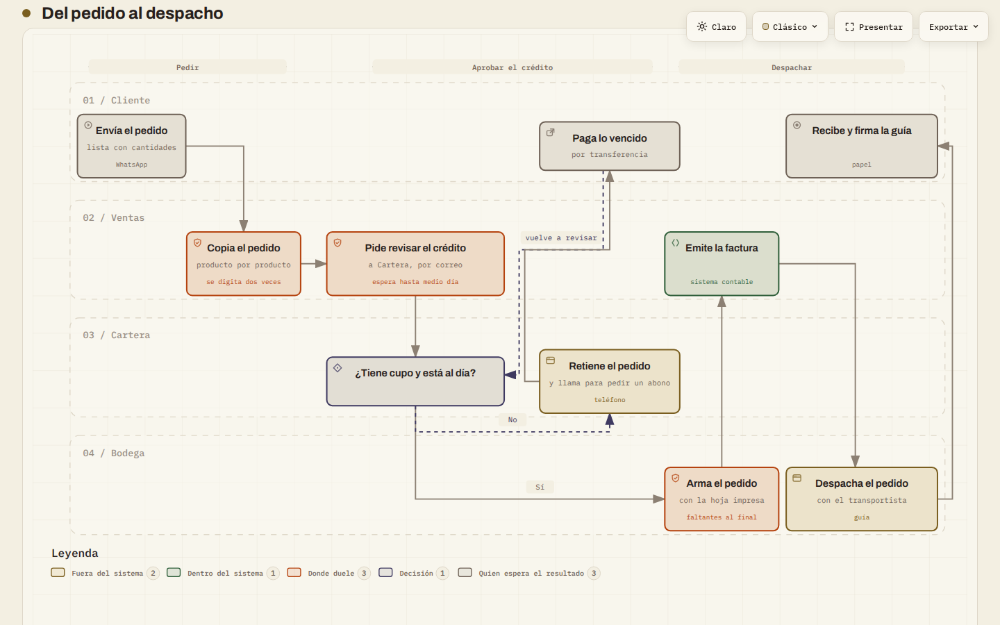
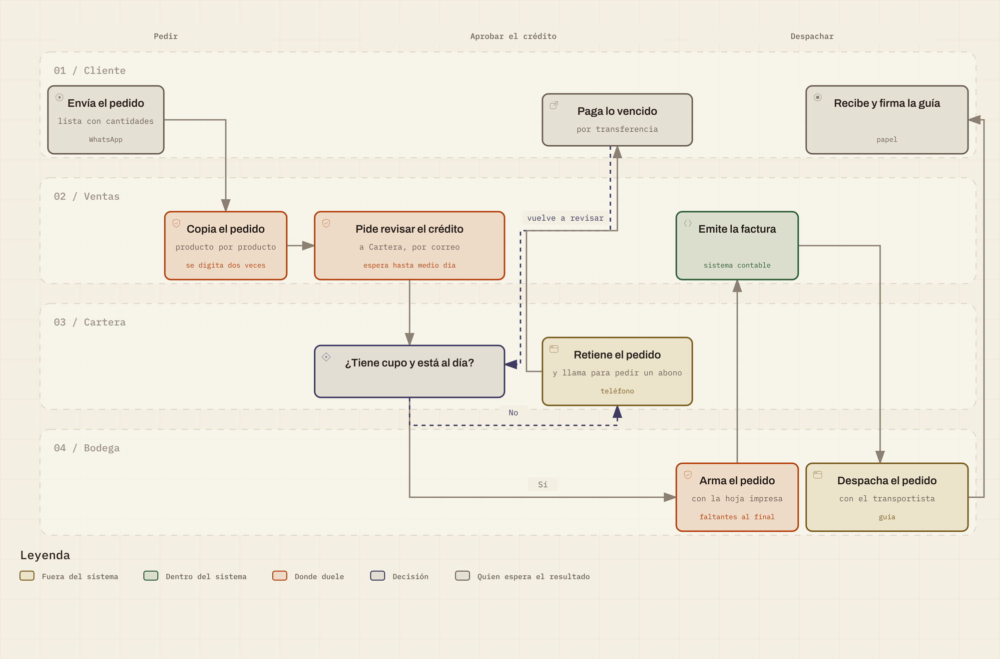
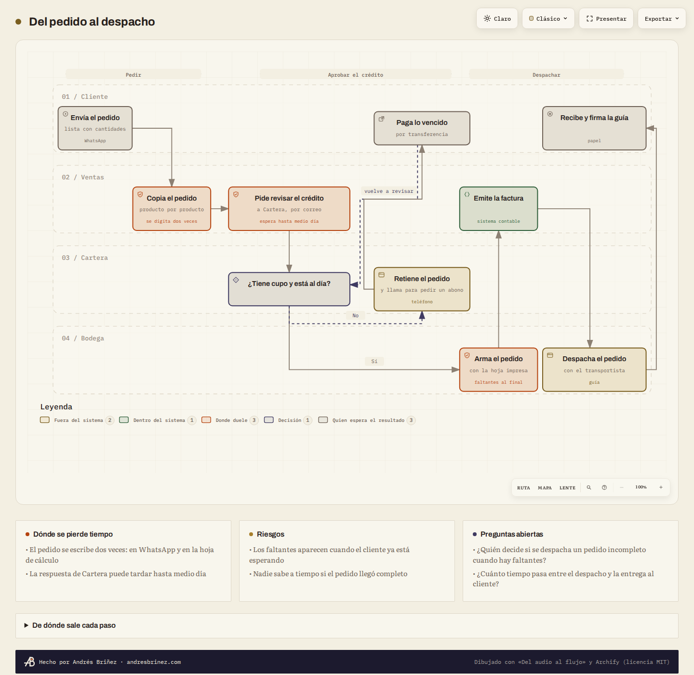
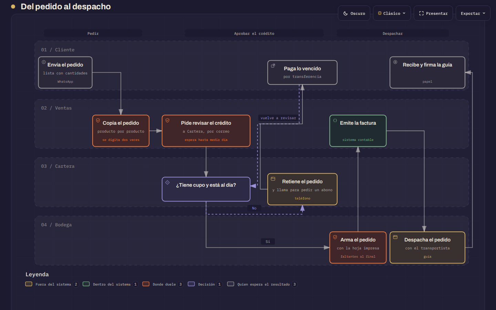
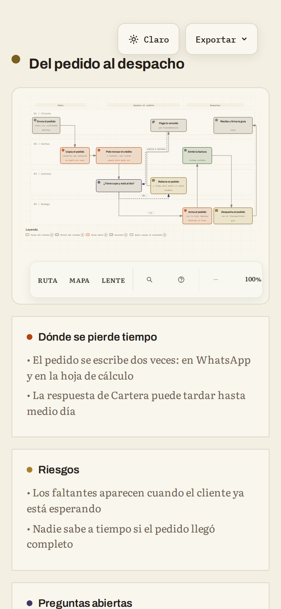

# Del audio al flujo

Cuente cómo funciona hoy un proceso de su empresa —quién hace qué, con qué
herramienta, dónde se atasca— y reciba el flujo dibujado por carriles, listo para
abrir en el navegador y guardar como imagen.



*Summary in English at the end: [In English](#in-english).*

## Qué hace

Usted cuenta el proceso con sus palabras: escrito, dictado o en una nota de voz.
Su asistente de inteligencia artificial (Claude) lo lee y lo ordena en carriles
(quién hace cada cosa), fases, pasos y decisiones, sin agregar nada que usted no
haya dicho. La herramienta lo dibuja y le entrega un archivo que se abre en
cualquier navegador.

En el dibujo se ve:

- **quién hace cada paso**, un carril por persona o área;
- **qué se hace a mano y qué dentro de un sistema**, con colores distintos;
- **dónde duele**: los pasos en los que usted dijo que se pierde tiempo o algo falla,
  marcados en naranja y con el problema escrito debajo;
- **las decisiones**, con sus respuestas («Sí», «No») en cada salida, y los
  reprocesos, como líneas que vuelven;
- **tarjetas** con dónde se pierde tiempo, los riesgos y las **preguntas abiertas**:
  lo que su relato no dice y conviene aclarar;
- **de dónde sale cada paso**: la frase exacta de su relato que lo respalda.

Desde el mismo navegador lo guarda como imagen PNG (para compartir) o SVG (para
editar).

La herramienta es gratuita y de código abierto, y corre en su computador.

## La forma más fácil: pídaselo a Claude

Si tiene **Claude Code** (en la app de escritorio de Claude o en la terminal), copie
este mensaje, complete la última parte y péguelo:

```text
Hola, Claude. Quiero usar «Del audio al flujo» en este computador.

1. Descargue el repositorio https://github.com/ACBRI/del-audio-al-flujo en mi
   carpeta Documentos (con git, o bajando el ZIP si no tengo git).
2. Lea su archivo SKILL.md y sígalo. Revise si tengo Python y Node; si falta algo,
   dígame qué es y pídame permiso antes de instalarlo.
3. Compruebe que funciona dibujando el ejemplo que trae.
4. Después dibuje el flujo de mi proceso con este relato:
   [pegue aquí el texto, o escriba dónde está el archivo de audio]

No invente pasos: lo que no esté en mi relato, pregúntemelo.
```

Claude instala lo que falte (con su permiso), adapta la herramienta a su computador,
escribe el modelo del proceso, lo dibuja y le dice dónde quedó el archivo. Si algo
no quedó como usted lo contó, dígaselo y vuelve a dibujar.

Si prefiere hacerlo a mano, siga leyendo.

## Qué necesita

- Un computador con Windows, macOS o Linux.
- **Python** 3.9 o más nuevo.
- **Node.js** 18 o más nuevo.
- Un navegador: Chrome, Edge, Firefox o Safari.
- Para escribir el modelo del proceso: Claude u otra IA que pueda leer archivos y
  correr órdenes en su computador.

No hace falta instalar nada más para dibujar.

## Instalación en Windows

1. **Python.** Entre a https://www.python.org/downloads/ y descargue la versión más
   reciente. Al abrir el instalador, marque la casilla **«Add python.exe to PATH»**
   y pulse «Install Now».
2. **Node.js.** Entre a https://nodejs.org, descargue la versión **LTS** y ejecute el
   instalador con las opciones que trae.
3. **La herramienta.** En la página del repositorio, pulse el botón verde **«Code»** y
   luego **«Download ZIP»**. En Descargas, haga clic derecho sobre el ZIP, elija
   «Extraer todo...» y extráigalo en Documentos. Queda una carpeta llamada
   `del-audio-al-flujo-main`.
4. **Abra una terminal en esa carpeta.** Ábrala en el Explorador de archivos, haga
   clic derecho en un espacio vacío y elija **«Abrir en Terminal»**. (En Windows 10:
   Mayúscula + clic derecho, «Abrir la ventana de PowerShell aquí».)
5. **Compruebe** que todo está listo:

   ```text
   py dibujar.py --comprobar
   ```

   Debe terminar con «Todo listo.». Si dice que falta algo, dice también cómo
   instalarlo. Si `py` no existe, use `python` en su lugar.
6. **Pruebe con el ejemplo:**

   ```text
   py dibujar.py ejemplos\pedido-a-despacho\proceso.json
   ```

   Se abre el navegador con el flujo de ejemplo.

## Instalación en Mac

1. **Python.** Abra la app Terminal (búsquela con Cmd + espacio) y escriba
   `python3 --version`. Si el Mac ofrece instalar las herramientas para
   desarrolladores, acepte: traen Python. Si prefiere, descárguelo de
   https://www.python.org/downloads/.
2. **Node.js.** Descargue la versión **LTS** de https://nodejs.org (instalador .pkg).
   Si usa Homebrew, también sirve `brew install node`.
3. **La herramienta.** Pulse **«Code»** y **«Download ZIP»** en la página del
   repositorio. Safari lo descomprime solo en Descargas; mueva la carpeta
   `del-audio-al-flujo-main` a Documentos.
4. **Abra la Terminal en esa carpeta:** escriba `cd ` (con un espacio al final),
   arrastre la carpeta a la ventana de la Terminal y pulse Enter.
5. **Compruebe** que todo está listo:

   ```text
   python3 dibujar.py --comprobar
   ```

6. **Pruebe con el ejemplo:**

   ```text
   python3 dibujar.py ejemplos/pedido-a-despacho/proceso.json
   ```

En **Linux** es igual que en Mac: instale `python3` y `nodejs` (18 o más nuevo) con
el gestor de paquetes de su distribución.

Si usa git, en vez del ZIP:

```text
git clone https://github.com/ACBRI/del-audio-al-flujo.git
```

## Cómo usarlo

El trabajo tiene tres partes: conseguir el relato en texto, convertirlo en el
modelo del proceso y dibujarlo. La segunda la hace su IA siguiendo `SKILL.md`; las
otras dos, la herramienta.

### Con un texto

Escriba el proceso como se lo contaría a un colega, o pegue una transcripción que ya
tenga. Sirve cualquier extensión, pero dos a cinco minutos de relato bastan. Cuente:

- qué lo dispara (un pedido, una factura que llega, el fin de mes);
- quién hace cada cosa y con qué (papel, WhatsApp, Excel, el sistema contable);
- qué se decide en el camino y qué pasa en cada caso;
- dónde se pierde tiempo o algo falla;
- cómo termina.

Péguelo en la conversación con Claude y pídale: «Dibuje el flujo de este proceso con
la herramienta Del audio al flujo». Claude guarda el texto como `relato.md` en una
carpeta nueva dentro de `mis-flujos/`, escribe el modelo y dibuja.

### Con un audio

**Opción A, la recomendada: transcribir con lo que ya tiene.** Después pegue el
texto como en la sección anterior.

- **Word en la web** (con una cuenta de Microsoft 365): abra un documento en
  https://www.office.com, vaya a **Inicio**, abra la flecha junto a **Dictar** y
  elija **Transcribir**. Puede subir el archivo de audio («Cargar audio») o grabar
  ahí mismo. Al terminar, pulse «Agregar al documento» y copie el texto.
- **Dictado de Windows:** abra el Bloc de notas o Word, pulse **Windows + H** y
  cuente el proceso en voz alta: el texto aparece mientras habla. Si no escribe en
  español, agregue el español en Configuración, «Hora e idioma», «Idioma y región».
- **Dictado de macOS:** actívelo en Configuración del Sistema, «Teclado»,
  «Dictado», y elija el español. Abra Notas o TextEdit, pulse la tecla del micrófono
  (o la combinación que el Mac indique) y hable.
- **Teléfono:** lo más seguro es dictar. Abra una nota (Notas en iPhone; Keep o la
  app de notas en Android), toque el **micrófono del teclado** y cuente el proceso.
  Si su teléfono transcribe las grabaciones (Notas de voz en los iPhone recientes,
  la Grabadora de los Pixel, la Grabadora de voz de Samsung en modo «Voz a texto» o
  la app Transcripción instantánea de Google), también sirve: copie el texto. Luego
  envíeselo a su computador, por ejemplo por correo.

**Opción B: transcribir en su computador, sin internet.** La herramienta trae
`transcribir.py`, que usa faster-whisper. Hay que instalarlo una vez:

```text
py -m pip install faster-whisper          (Windows)
python3 -m pip install faster-whisper     (Mac y Linux)
```

La **primera vez descarga un modelo de reconocimiento de voz de unos 500 MB** a su
computador; después funciona sin internet y el audio no sale de su equipo. Lee mp3,
m4a, wav, ogg, webm y casi cualquier otro formato:

```text
py transcribir.py C:\ruta\nota-de-voz.m4a --salida mis-flujos\mi-proceso\relato.md
```

Un audio de diez minutos tarda unos minutos; cuántos depende del computador. Revise
nombres propios y cifras antes de dibujar: es donde más se equivoca cualquier
transcripción automática.

### Qué esperar

Al dibujar, la herramienta dice en la terminal si el modelo tiene errores (y cuáles),
si alguna frase citada no aparece en su relato y qué preguntas quedaron abiertas.
Luego abre el dibujo en el navegador. Todo queda en la carpeta del proceso:

| Archivo | Qué es |
| --- | --- |
| `relato.md` | Su relato, tal como lo dio |
| `proceso.json` | El modelo del proceso que escribió la IA |
| `flujo.html` | El dibujo: ábralo con cualquier navegador |
| `flujo.archify.json` | La especificación del dibujo, para quien quiera editarla |

Si el proceso es largo y no cabe en un dibujo, sale en partes enlazadas entre sí:
`flujo-parte-1.html`, `flujo-parte-2.html`...

### Cómo guardar la imagen

En el dibujo abierto, pulse **«Exportar»**, arriba a la derecha:

- **PNG**: una imagen para compartir por WhatsApp, correo o presentación.
- **SVG**: una imagen que se puede agrandar sin perder nitidez y editar en programas
  de diseño.

Con «Claro» y «Oscuro» cambia el fondo antes de exportar.



### Cómo corregirlo

Dígale a Claude qué cambiar («el cupo lo aprueba el gerente, no Cartera»; «falta el
paso en que bodega llama al cliente») o responda las preguntas abiertas. Claude
actualiza el modelo y vuelve a dibujar. Quien prefiera editar a mano puede cambiar
`proceso.json` y correr de nuevo `dibujar.py`.

## Cómo leer el dibujo

| Color | Significa |
| --- | --- |
| Ocre (sabana) | Fuera del sistema: trabajo a mano, en papel, por teléfono, WhatsApp u hojas de cálculo |
| Verde (morichal) | Dentro del sistema: trabajo hecho en un programa (ERP, contabilidad, inventario, portal) |
| Naranja (candela) | Donde duele: lo que usted dijo que demora o falla; debajo dice qué |
| Violeta oscuro, con rombo | Decisión: cada salida lleva su respuesta |
| Gris tierra | Quien espera el resultado: cliente, proveedor u otra persona de fuera |

- Las **líneas punteadas** son la otra salida de una decisión o una vuelta atrás (un
  reproceso).
- Arriba van las **fases**; a la izquierda, los **carriles** numerados.
- Al pasar el cursor sobre un paso aparece la frase de su relato que lo respalda.
- Debajo del dibujo, las tarjetas y la sección **«De dónde sale cada paso»**.
- En el visor también puede acercar, buscar un paso («/») y presentar a pantalla
  completa.

## Un ejemplo

Distribuidora La Garza es una comercializadora inventada de productos de limpieza.
Así contaría su jefa de ventas el proceso de un pedido, en una nota de voz de dos
minutos (el texto completo está en `ejemplos/pedido-a-despacho/relato.md`):

> Bueno, le cuento cómo funciona hoy un pedido aquí en la distribuidora. El cliente
> nos escribe por WhatsApp con lo que necesita, casi siempre una lista con
> cantidades. La vendedora copia el pedido a una hoja de cálculo, producto por
> producto, o sea que se digita dos veces.
>
> Después le escribe por correo a Cartera para que revise el crédito, y ahí el pedido
> espera; a veces la respuesta llega hasta medio día después. En Cartera miran si el
> cliente tiene cupo y si está al día. Si debe facturas vencidas, retienen el pedido
> y lo llaman para pedirle un abono. Cuando el cliente paga lo vencido por
> transferencia, Cartera vuelve a revisar.
>
> Si todo está bien, la vendedora imprime la hoja y la manda a bodega. En bodega
> arman el pedido con la hoja impresa, y muchas veces los faltantes se descubren al
> final, cuando el cliente ya está esperando. Con el pedido armado, la vendedora
> emite la factura en el sistema contable. Luego bodega despacha con el
> transportista y una guía. El cliente recibe y firma la guía de entrega, y esa guía
> vuelve a la oficina en papel, así que nadie sabe a tiempo si el pedido llegó
> completo.

El modelo que sale de ese relato está en `ejemplos/pedido-a-despacho/proceso.json`:
cuatro carriles, tres fases, diez pasos, una decisión de crédito con su reproceso,
tres puntos de dolor y dos preguntas abiertas. Este es el resultado, completo, con
las tarjetas y el pie:



En tema oscuro:



Y en un teléfono, donde se acerca con los dedos o con los botones del visor:



## Preguntas frecuentes

**¿Cuánto cuesta?** La herramienta es gratuita. Lo que consume es el uso de su IA:
con una suscripción de Claude entra en su plan; con la API, un flujo cuesta unos
centavos de dólar. La transcripción de la opción B no cuesta nada.

**¿Funciona con otra IA?** Sí, con cualquiera que pueda leer los archivos del
repositorio y correr órdenes en su computador. Las reglas están en
`prompts/proceso.md` y la forma del modelo en `esquemas/proceso.schema.json`.

**¿Y en claude.ai, sin instalar nada?** Si su plan permite subir habilidades
(Configuración, Capacidades), puede subir el ZIP del repositorio como habilidad.
Claude dibuja en su propio entorno y le entrega el archivo HTML para descargar. Este
camino depende del plan y no lo he probado en todos.

**¿Claude puede recordar la herramienta para la próxima vez?** Sí: pídale que
instale esta carpeta como habilidad personal de Claude Code. Desde entonces basta
con decirle «dibuje el flujo de este proceso».

**¿Qué pasa si mi relato es desordenado?** Es lo normal. La IA ordena los pasos y
lo que no queda claro lo convierte en preguntas abiertas en lugar de adivinar.

**¿Puedo contar el proceso en inglés?** Sí. El dibujo sale en el idioma del relato,
español o inglés, con el visor en ese idioma.

**¿El dibujo muestra cómo debería ser el proceso?** No: muestra cómo es hoy, según
su relato. Para eso sirve: ver dónde se pierde tiempo antes de decidir qué cambiar.

**¿Puedo editar el dibujo?** Pídale el cambio a Claude, o edite `proceso.json` y
vuelva a dibujar. El SVG exportado también se abre en programas de diseño.

**¿Cuántos pasos admite?** Hasta 40. Con más de 12 o 15, el proceso suele salir en
dos o más partes enlazadas.

## Problemas comunes

| Síntoma | Qué hacer |
| --- | --- |
| `py` o `python3` no se reconoce | Instale Python. En Windows, al instalarlo marque «Add python.exe to PATH»; cierre y abra de nuevo la terminal |
| «No encontré Node.js» | Instale Node.js LTS desde https://nodejs.org y abra de nuevo la terminal |
| «El modelo tiene errores» | El mensaje dice cuáles y dónde: pídale a Claude que los corrija |
| «La cita del paso ... no aparece tal cual en el relato» | La IA cambió alguna palabra al citar. Pídale que copie la frase exacta; si el paso no está en su relato, que lo quite |
| El navegador no se abre solo | Abra a mano el archivo `flujo.html` de la carpeta del proceso (doble clic) |
| El dibujo se ve muy pequeño | Use los botones «+» y «−» del visor, o «Presentar» para verlo a pantalla completa |
| «Exportar» no descarga nada | Pruebe con otro navegador; Chrome, Edge y Firefox exportan PNG y SVG |
| `transcribir.py` pide faster-whisper | Es la opción B: instálelo como se explica arriba, o use la opción A |
| La transcripción tiene errores | Corrija el texto antes de dibujar, sobre todo nombres y cifras |

## Privacidad

- `dibujar.py` y `transcribir.py` corren en su computador. El dibujo no carga nada de
  internet: las tipografías y el visor van dentro del archivo.
- Lo único que sale de su computador es lo que usted le comparte a su IA, según las
  condiciones de su cuenta.
- La opción A transcribe con servicios de Microsoft, Apple o Google, según el que use.
  Si el proceso es confidencial, la opción B lo hace todo en su equipo.
- Nada llega a Andrés Briñez ni a nadie más: la herramienta no tiene servidor ni
  registra uso.
- La carpeta `mis-flujos/` está excluida de git, para que sus procesos no se suban
  por error si usted publica cambios.

## Para quien programa

```text
SKILL.md                 instrucciones para la IA (formato de habilidad para agentes)
prompts/proceso.md       reglas para pasar del relato al modelo intermedio
esquemas/                JSON Schema del modelo intermedio
dibujar.py               orden: modelo -> dibujo
transcribir.py           orden opcional: audio -> relato.md (faster-whisper)
flujo/                   el código: modelo, convertidor, Archify, marca, idioma
vendor/archify/          Archify 2.17 (MIT), sin cambios
ejemplos/                el ejemplo resuelto
tests/                   pruebas con pytest y procesos ficticios
herramientas/            capturas y prueba de la exportación (solo para mantener)
```

El convertidor ubica cada paso una columna a la derecha del paso que lo precede,
con un tramo de columnas por fase; las vueltas no cuentan para el orden. Archify
admite seis columnas: si hacen falta más, junta columnas vecinas cuyos pasos están en
carriles distintos (el traspaso queda vertical), sin juntarlas cuando la línea
atravesaría otro paso. Si aun así no cabe, parte el proceso en dibujos enlazados sin
cortar un reproceso por la mitad. Después valida con Archify en su calidad más
exigente, corrige lo que el compilador señala (anchos, rutas) y entrega. Los
detalles están en los comentarios de `flujo/convertidor.py` y `flujo/archify.py`.

Pruebas:

```text
python3 -m pip install pytest jsonschema
python3 -m pytest
```

Las capturas de este README salen de `python3 herramientas/capturas.py`, que dibuja
el ejemplo, lo fotografía con un Chromium sin ventana y pulsa «Exportar» para guardar
la imagen PNG.

## Créditos y licencia

- **Archify**, de tt-a1i, es el compilador que dibuja los flujos: licencia MIT,
  https://github.com/tt-a1i/archify. Va copiado sin cambios en `vendor/archify/`.
- Las tipografías **Archivo**, **Literata** e **IBM Plex Mono** se distribuyen bajo
  la SIL Open Font License 1.1 (`flujo/recursos/fuentes/LICENCIA.md`).
- **faster-whisper** (MIT), opcional, para la transcripción local.
- Detalle en `THIRD_PARTY_NOTICES.md`.

«Del audio al flujo» se publica bajo la licencia MIT (`LICENSE`).

## In English

**Del audio al flujo** ("from audio to flow") turns a spoken or written account of a
business process into a swimlane flow diagram: who does what, with which tool,
where time is lost, which decisions are made. The result is a self-contained HTML
file that opens in any browser and exports to PNG or SVG.

How it works: your AI assistant (Claude) reads the account and writes an
intermediate model following `prompts/proceso.md` and `esquemas/proceso.schema.json`
— it must not invent steps or roles, every step carries the exact sentence that
supports it, and anything missing becomes an open question. Then `dibujar.py`
converts the model into an Archify workflow (six columns, lanes, phases, labelled
decision branches, rework loops, notes as cards), validates it, applies the
"Sabana y candela" brand skin and opens it.

The easiest way, with Claude Code:

```text
Hi Claude. I want to use "Del audio al flujo" on this computer.
1. Download https://github.com/ACBRI/del-audio-al-flujo into my Documents folder.
2. Read its SKILL.md and follow it. Check whether I have Python and Node; if
   something is missing, tell me what it is and ask before installing it.
3. Check that it works by drawing the bundled example.
4. Then draw the flow of my process from this account: [paste the text, or the
   path to the audio file]
Do not invent steps: ask me about anything my account does not say.
```

Requirements: Python 3.9+ and Node.js 18+. Check with `python3 dibujar.py
--comprobar` (`py` on Windows); draw with `python3 dibujar.py path/to/proceso.json`.
Audio: transcribe it with what you already have (Word for the web, Windows or macOS
dictation, your phone) or locally with `transcribir.py` (faster-whisper; downloads a
~500 MB model the first time). Everything runs on your computer; nothing is sent to
the author. Accounts in English produce drawings in English.

Credits: Archify by tt-a1i (MIT) draws the diagrams. MIT license.

---

Hecho por Andrés Briñez · [andresbrinez.com](https://andresbrinez.com)
